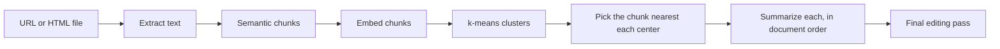

# Large Document Summarizer

Summarizes documents too long to send to a model in one piece, like a novel or a long report.
Instead of summarizing every page, it finds the passages that best represent each part of the
document and summarizes those, which cuts the tokens sent by a lot.

Built in 2024 with LangChain, OpenAI embeddings, and FAISS, as a way to learn how embeddings
and clustering can do real work in an LLM pipeline.

## How it works



1. **Load.** Pulls the paragraph text out of a web page or an uploaded HTML file.
2. **Chunk by meaning.** LangChain's `SemanticChunker` splits the text where the topic shifts,
   using OpenAI embeddings, instead of at a fixed size.
3. **Cluster.** Every chunk is embedded (`text-embedding-3-small`) and FAISS runs k-means on the
   vectors. The number of clusters is the number of chunks times a slider value, so you choose
   how much of the document to keep.
4. **Pick representatives.** For each cluster center, FAISS finds the nearest real chunk. Those
   chunks are put back in their original order so the summary still reads front to back.
5. **Summarize.** GPT-4o summarizes each representative chunk, then a final pass edits the
   pieces into one flowing summary without repetition.
6. **Report.** A table shows tokens in the original, tokens actually sent, and the size of the
   rough and final summaries.

Clustering can be turned off to summarize every chunk, which makes a useful comparison.

## Usage

```bash
pip install -r requirements.txt
export OPENAI_API_KEY=sk-...      # Windows: set OPENAI_API_KEY=sk-...
streamlit run app.py
```

Paste a URL or upload an HTML file, click **Load document**, pick a cluster multiplier, and click
**Summarize**. Long-form text from Project Gutenberg works well for trying it.

## What I learned

- Clustering is a cheap, effective way to choose what to read. A multiplier around 0.5 halved the
  tokens sent while keeping the main threads of the story.
- Semantic chunking gives better units than fixed-size chunks, but it costs an embedding pass
  over the whole document up front.
- The weak spot is the stitching: summaries of separate chunks repeat each other, which is why
  the final editing pass exists.

## Status

A 2024 learning project, kept as is. Long-context models have since made some of this
unnecessary for mid-sized documents, but the select-then-summarize idea still applies to very
large ones.
